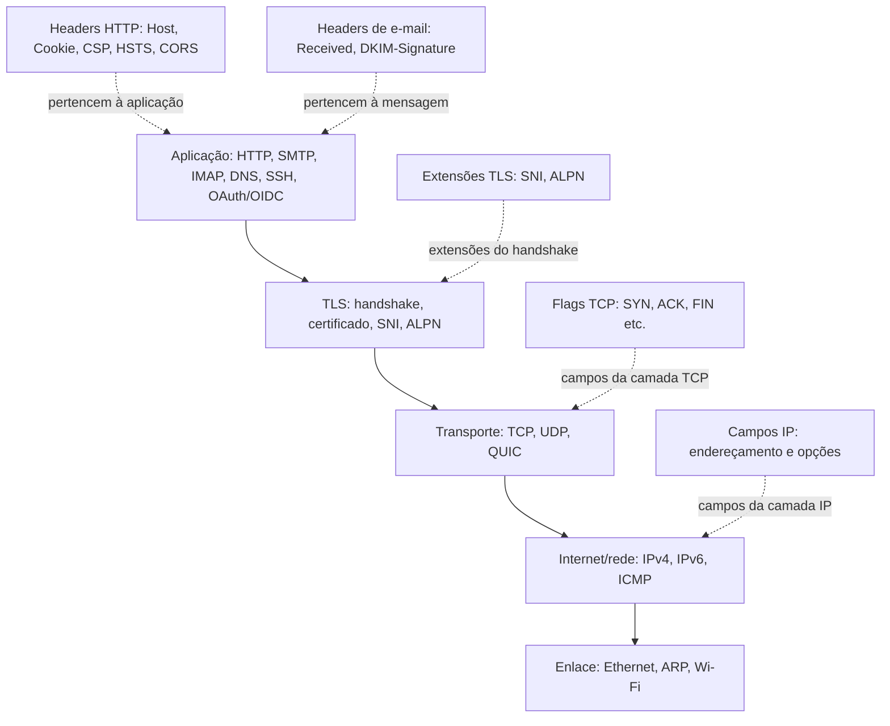

# Protocolos e Cabeçalhos — Guia de Segurança para Profissionais

Guia prático em português para entender protocolos de rede, web, e-mail e autenticação sob a perspectiva de segurança, inspeção e resposta. Use os exemplos somente em sistemas e redes que você administra ou tem autorização para avaliar.

## Respostas rápidas

| Pergunta do profissional | Onde ir | Fonte oficial |
|---|---|---|
| Como funciona o TLS handshake? | [TLS](docs/protocolos/tls.md) | [RFC 8446](https://www.rfc-editor.org/rfc/rfc8446) |
| Quais headers HTTP de segurança devo configurar? | [Headers de segurança](docs/cabecalhos/http-seguranca.md) | [MDN](https://developer.mozilla.org/docs/Web/HTTP/Headers) / [OWASP](https://owasp.org/www-project-secure-headers/) |
| Como detectar DNS tunneling? | [DNS](docs/protocolos/dns.md) | [RFC 1035](https://www.rfc-editor.org/rfc/rfc1035) + [IANA](https://www.iana.org/assignments/dns-parameters/dns-parameters.xhtml) |
| Como o CORS pode ser mal configurado? | [CORS](docs/cabecalhos/cors.md) | [Fetch Standard](https://fetch.spec.whatwg.org/) |
| Como inspecionar tráfego no Wireshark? | [Guia de inspeção](docs/como-inspecionar.md) | — |

## Mapa em camadas

Headers HTTP e de e-mail pertencem aos respectivos protocolos de aplicação; não são headers da camada IP/TCP. Em HTTP/3, HTTP é transportado sobre QUIC/UDP. [Visão geral](docs/protocolos/camada-transporte.md).

## Quick Start

1. Consulte o [glossário](docs/glossario.md) para alinhar as siglas.
2. Prepare a [inspeção](docs/como-inspecionar.md) com ferramentas locais.
3. Abra o [protocolo](docs/protocolos/) ou [header](docs/cabecalhos/) de interesse.

## Índice

- [Protocolos](docs/protocolos/): [rede](docs/protocolos/camada-rede.md), [transporte](docs/protocolos/camada-transporte.md), [DNS](docs/protocolos/dns.md), [TLS](docs/protocolos/tls.md), [HTTP](docs/protocolos/http.md), [e-mail](docs/protocolos/email.md), [autenticação](docs/protocolos/autenticacao.md), [SSH](docs/protocolos/ssh.md).
- [Cabeçalhos](docs/cabecalhos/): [HTTP segurança](docs/cabecalhos/http-seguranca.md), [HTTP gerais](docs/cabecalhos/http-gerais.md), [CORS](docs/cabecalhos/cors.md), [e-mail](docs/cabecalhos/email-headers.md), [rede](docs/cabecalhos/rede.md).
- [Guia de inspeção](docs/como-inspecionar.md) · [glossário](docs/glossario.md) · [fontes oficiais](data/links-oficiais.md).

Os padrões evoluem: confirme sempre a versão vigente nas fontes primárias. Veja também as [orientações de contribuição](.github/copilot-instructions.md).
