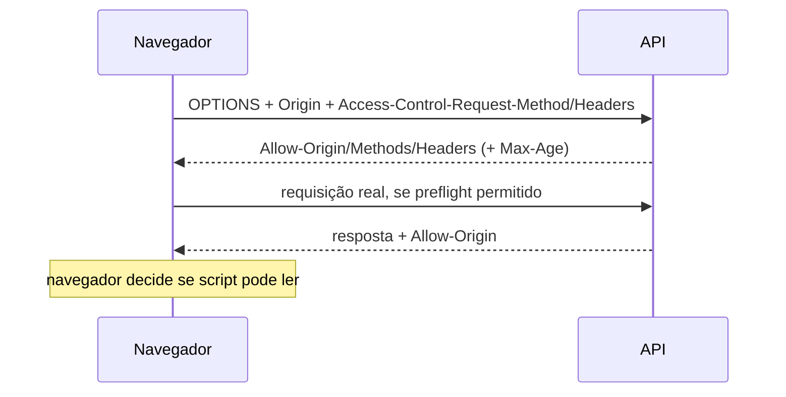

# CORS

## 1. O que é / para que serve

CORS (Cross-Origin Resource Sharing) é o mecanismo do navegador que permite ou bloqueia scripts cross-origin de ler respostas. É definido pelo [Fetch Standard (WHATWG)](https://fetch.spec.whatwg.org/); não é controle de autenticação nem firewall.

## 2. Sintaxe

Uma requisição simples pode levar `Origin: https://app.example`; a resposta pode incluir `Access-Control-Allow-Origin: https://app.example`. Para credenciais, resposta explícita pode incluir `Access-Control-Allow-Credentials: true`; métodos/headers permitidos ficam em `Access-Control-Allow-Methods` e `Access-Control-Allow-Headers`.



## 3. Valor seguro recomendado

Use allowlist exata de origens necessárias. Com credenciais, responda origem específica (nunca `*`), `Access-Control-Allow-Credentials: true` somente quando necessário e `Vary: Origin` se a resposta variar. Limite métodos/headers e valide `Origin` como origem, não por substring.

## 4. Ausência ou má configuração

Sem permissão CORS o navegador impede leitura pelo script, mas a API ainda pode ser acessível por outros clientes. Refletir Origin sem validação, permitir credenciais a origens não confiáveis ou expor dados privados pode viabilizar leitura cross-site em navegadores autenticados. `*` com credenciais não é aceito pelo navegador segundo Fetch.

## 5. Como verificar

Em endpoint autorizado:

```sh
curl -i -H 'Origin: https://untrusted.example' https://$HOST/api/
curl -i -X OPTIONS -H 'Origin: https://app.example' -H 'Access-Control-Request-Method: POST' -H 'Access-Control-Request-Headers: content-type' https://$HOST/api/
```

Confira Network no navegador, incluindo preflight e resposta real. curl mostra headers, mas não aplica política CORS.

## 6. Links oficiais

[Fetch Standard: CORS](https://fetch.spec.whatwg.org/#http-cors-protocol) · [MDN CORS](https://developer.mozilla.org/docs/Web/HTTP/CORS) · [OWASP CORS](https://owasp.org/www-community/attacks/CORS_OriginHeaderScrutiny).