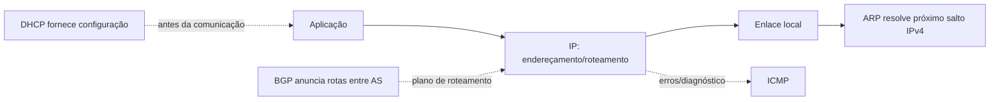

# Camada de rede

## 1. O que é

IP (Internet Protocol) encaminha datagramas; IPv4 é definido pela [RFC 791](https://www.rfc-editor.org/rfc/rfc791) e IPv6 pela [RFC 8200](https://www.rfc-editor.org/rfc/rfc8200). ICMP comunica erros/diagnóstico ([RFC 792](https://www.rfc-editor.org/rfc/rfc792), [RFC 4443](https://www.rfc-editor.org/rfc/rfc4443)); ARP resolve IPv4 para enlace ([RFC 826](https://www.rfc-editor.org/rfc/rfc826)); DHCPv4 configura clientes ([RFC 2131](https://www.rfc-editor.org/rfc/rfc2131)); BGP troca rotas entre sistemas autônomos ([RFC 4271](https://www.rfc-editor.org/rfc/rfc4271)).

## 2. Como funciona

IPv4/IPv6 não estabelecem conexão. ICMP echo sustenta ping; traceroute infere saltos por respostas ICMP/time exceeded, podendo ser filtrado. ARP é local ao enlace. DHCP segue discover/offer/request/ack. BGP seleciona e anuncia rotas segundo política, não é um protocolo de autenticação de origem por padrão.

## 3. Relevância de segurança

Endereços IP são contexto, não identidade. Spoofing pode comprometer atribuição; ARP e DHCP locais exigem controles de camada 2; rotas BGP incorretas podem desviar tráfego. ICMP pode revelar topologia, mas bloqueio indiscriminado quebra diagnóstico e PMTUD.

## 4. Ataques comuns

- **ARP spoofing**: exige presença no mesmo domínio de broadcast; indicadores incluem mapeamento IP/MAC oscilante e anúncios ARP inesperados.
- **Rogue DHCP**: servidor não autorizado alcança clientes; alertas incluem gateway/DNS divergente e respostas DHCP concorrentes.
- **BGP route hijack/leak**: anúncio indevido/propagação incorreta; monitore mudanças de origem AS, RPKI invalid e alertas de route collector.
- **ICMP tunneling**: canal encoberto pode existir em redes permissivas; procure volume/padrões anormais e violações da política, sem presumir que todo ICMP é malicioso.

## 5. O que monitorar

Logs de DHCP snooping, tabelas ARP/ND, alterações de rota, validação RPKI, ICMP por tipo/volume e relação entre origem declarada e ponto de entrada. Na captura: `arp`, `icmp`, `icmpv6`, `bootp`, `ip`.

## 6. Como inspecionar na prática

Veja [guia de inspeção](../como-inspecionar.md). Em rede própria, filtre `arp || bootp || icmp || icmpv6`; compare leases DHCP com gateway/DNS aprovados. `ip neigh` (Linux) mostra vizinhos locais. Não use endereços de terceiros para atribuição conclusiva.

## 7. Erros comuns / más configurações

Confiar apenas no IP de origem; deixar portas de acesso sem DHCP snooping/DAI quando suportados; ignorar RPKI e filtros de prefixo; bloquear ICMP necessário; tratar traceroute incompleto como prova de ocultação.

## 8. Links oficiais

[IPv4 RFC 791](https://www.rfc-editor.org/rfc/rfc791) · [IPv6 RFC 8200](https://www.rfc-editor.org/rfc/rfc8200) · [ARP RFC 826](https://www.rfc-editor.org/rfc/rfc826) · [DHCP RFC 2131](https://www.rfc-editor.org/rfc/rfc2131) · [BGP RFC 4271](https://www.rfc-editor.org/rfc/rfc4271) · [IANA Protocol Numbers](https://www.iana.org/assignments/protocol-numbers/protocol-numbers.xhtml).