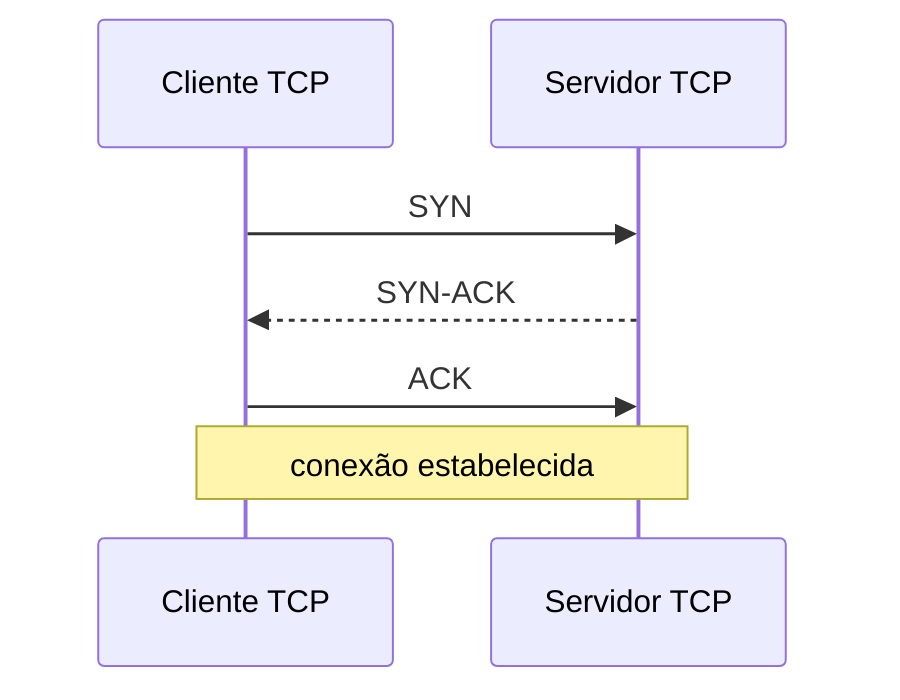

# Camada de transporte

## 1. O que é

TCP (Transmission Control Protocol, [RFC 9293](https://www.rfc-editor.org/rfc/rfc9293)) fornece fluxo confiável; UDP (User Datagram Protocol, [RFC 768](https://www.rfc-editor.org/rfc/rfc768)) envia datagramas sem conexão. QUIC ([RFC 9000](https://www.rfc-editor.org/rfc/rfc9000)) é transporte seguro sobre UDP, usado por HTTP/3.

## 2. Como funciona

TCP inicia conexão com three-way handshake; números de sequência e ACK sustentam entrega ordenada (RFC 9293). UDP não tem handshake próprio. QUIC combina estabelecimento criptográfico e transporte; streams independentes reduzem bloqueio entre fluxos (RFC 9000).

## 3. Relevância de segurança

Portas e estados ajudam a identificar serviços e padrões, mas não determinam intenção. SYN flood consome estado/recursos; varreduras podem preceder intrusão. UDP sem controle de origem e serviços expostos podem participar de amplificação. QUIC cifra mais metadados de transporte, reduzindo visibilidade passiva.

## 4. Ataques comuns

- **SYN flood**: volume anormal de SYN sem conclusão; monitore meia-conexões, backlog e mitigação do provedor.
- **Varredura de portas**: muitas tentativas a portas/hosts em curto período; correlacione origem, destino e respostas SYN/RST, respeitando a autorização.
- **Amplificação UDP**: serviço refletor responde muito mais do que recebe a uma origem falsificada; procure respostas sem consulta correspondente e aplique controle de abuso/egress.

## 5. O que monitorar

Distribuição de portas, conexões incompletas, retransmissões, resets, bytes por fluxo e razão requisição/resposta. Filtros: `tcp.flags.syn == 1`, `tcp.flags.reset == 1`, `udp`, `quic`.

## 6. Como inspecionar na prática

Use **Follow TCP Stream** no Wireshark para fluxo TCP não criptografado ou já decifrado. `tshark -r captura.pcapng -Y 'tcp.flags.syn==1 && tcp.flags.ack==0'` filtra SYN iniciais. Para QUIC, veja [inspeção](../como-inspecionar.md) e [HTTP](http.md); payload cifrado não é legível sem material autorizado.

## 7. Erros comuns / más configurações

Expor serviços desnecessários; considerar UDP “inofensivo”; confiar somente em firewall de borda; supor que toda conexão sem ACK é ataque; esperar inspeção de conteúdo de QUIC sem chaves.

## 8. Links oficiais

[TCP RFC 9293](https://www.rfc-editor.org/rfc/rfc9293) · [UDP RFC 768](https://www.rfc-editor.org/rfc/rfc768) · [QUIC RFC 9000](https://www.rfc-editor.org/rfc/rfc9000) · [HTTP/3 RFC 9114](https://www.rfc-editor.org/rfc/rfc9114).