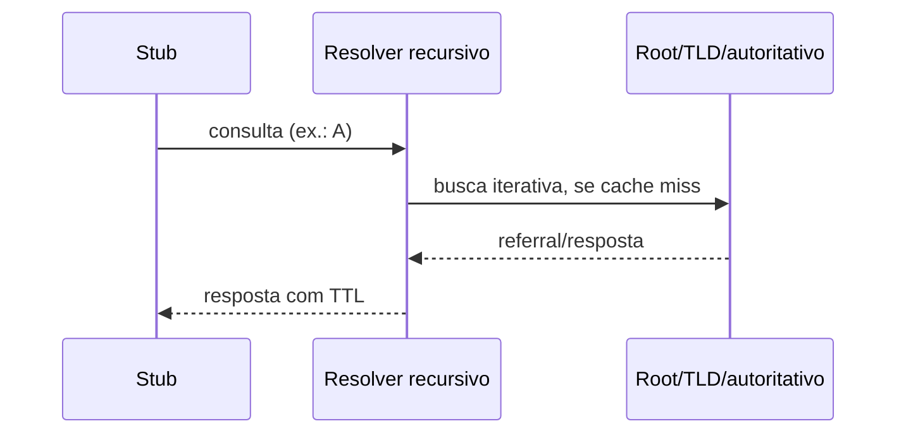

# DNS

## 1. O que é

DNS (Domain Name System) associa nomes a dados distribuídos por zonas. Conceitos e protocolo estão nas [RFCs 1034](https://www.rfc-editor.org/rfc/rfc1034) e [1035](https://www.rfc-editor.org/rfc/rfc1035); tipos são registrados pela [IANA](https://www.iana.org/assignments/dns-parameters/dns-parameters.xhtml).

## 2. Como funciona

O stub consulta um resolvedor recursivo; este usa cache ou segue referrals até servidor autoritativo. A resposta é cacheada pelo TTL. A, AAAA, CNAME, MX, NS, TXT e SOA têm funções distintas. DNSSEC valida origem/integridade dos dados assinados, mas não cifra consultas ([RFC 4033](https://www.rfc-editor.org/rfc/rfc4033)). DoT cifra DNS sobre TLS ([RFC 7858](https://www.rfc-editor.org/rfc/rfc7858)); DoH usa HTTPS ([RFC 8484](https://www.rfc-editor.org/rfc/rfc8484)).

## 3. Relevância de segurança

DNS expõe metadados de navegação a resolvedores; criptografia de transporte não substitui validação DNSSEC nem política de endpoint. Cache poisoning depende de aceitação de dados forjados; randomização e validação reduzem risco. Enumeração de nomes pode revelar ativos.

## 4. Ataques comuns

- **Cache poisoning/spoofing**: resposta falsa aceita por resolvedor; observe respostas inconsistentes, mudanças não explicadas e falhas DNSSEC.
- **DNS tunneling**: dados codificados em consultas/respostas; indícios são labels longos/aleatórios, alta entropia, volume e NXDOMAIN atípicos. Nenhum indicador isolado confirma túnel.
- **Enumeração de subdomínios**: descoberta de nomes por fontes públicas/consultas; monitore consultas anormais e ativos apontando a serviços desativados.

## 5. O que monitorar

Qname, tipo, resposta/rcode, cliente, resolver, tamanho, frequência, entropia e volume por domínio. Filtros: `dns`, `dns.qry.name contains "example"`, `dns.flags.rcode != 0`. DoH/DoT podem ocultar nomes da captura de rede; use logs do resolver gerenciado.

## 6. Como inspecionar na prática

Veja comandos `dig` e tshark em [como inspecionar](../como-inspecionar.md). Para DNSSEC, `dig +dnssec "$HOST" A`; o bit AD depende do resolver e não é, sozinho, validação do cliente.

## 7. Erros comuns / más configurações

Deixar recursão aberta à Internet; registros órfãos; confiar em TXT como prova de identidade; interpretar `ANY` como dump completo (RFC 8482); bloquear DoH/DoT sem política clara; ignorar split-horizon e TTL.

## 8. Links oficiais

[RFC 1034](https://www.rfc-editor.org/rfc/rfc1034) · [RFC 1035](https://www.rfc-editor.org/rfc/rfc1035) · [DNSSEC RFC 4033](https://www.rfc-editor.org/rfc/rfc4033) · [DoT RFC 7858](https://www.rfc-editor.org/rfc/rfc7858) · [DoH RFC 8484](https://www.rfc-editor.org/rfc/rfc8484) · [IANA DNS Parameters](https://www.iana.org/assignments/dns-parameters/dns-parameters.xhtml).